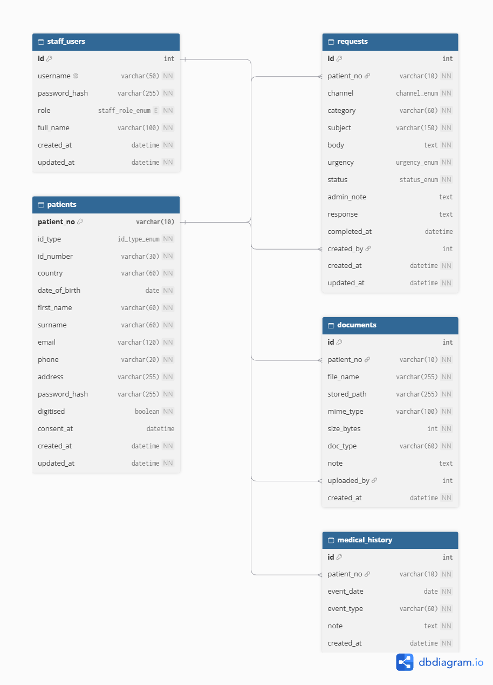

# Group 18
Stefan du Toit 24607772

Joshua Smit 24577155

Tendaishe Mhuriro 23589711


# Database setup (MySQL)

MediLink stores everything in MySQL 8. There are two databases. `medilink` is the one the app uses. `medilink_test` is an empty one that pytest wipes and refills every run, so the tests never touch your real data.

## 1. Create the two databases

Open MySQL Workbench (or the MySQL command line) and run this once.

```sql
CREATE DATABASE medilink CHARACTER SET utf8mb4 COLLATE utf8mb4_unicode_ci;
CREATE DATABASE medilink_test CHARACTER SET utf8mb4 COLLATE utf8mb4_unicode_ci;
```

You don't create the tables yourself. `seed.py` builds them from `schema.sql`.

## 2. Make your .env file

Copy `.env.example` to a new file called `.env` in the project folder and put in your own MySQL password and a long random secret key.

```
FLASK_ENV_NAME=development
SECRET_KEY=put-a-long-random-string-here
DB_HOST=127.0.0.1
DB_PORT=3306
DB_USER=root
DB_PASSWORD=your-mysql-password
DB_NAME=medilink
TEST_DB_NAME=medilink_test
```

`.env` is in `.gitignore`, so your password never goes to GitHub.

## 3. Install the packages and run the seed

In the VS Code terminal, from the project folder:

```
python -m venv venv
venv\Scripts\activate            (Windows)   or   source venv/bin/activate   (Mac)
pip install -r requirements.txt
python seed.py
```

Type `yes` when it asks. The seed drops and rebuilds all five tables from `schema.sql`, then loads the demo data. It prints a row count for each table when it's done.

| Table | Demo rows |
|---|---|
| staff_users | 2 |
| patients | 9 |
| requests | 11 |
| documents | 8 |
| medical_history | 8 |

The 8 document rows each point at a small real PDF that the seed writes into `uploads/<patient_no>/`, so they open and download in the app just like a real upload. The four digitised patients (ML-1001, ML-1002, ML-1004, ML-1007) each have their scanned paper file.

Run `python seed.py` again at any time to reset the demo data. Use `python seed.py --yes` to skip the question.

## 4. Run the app and the tests

```
python app.py
python -m pytest
```

## Demo logins

| Role | Username | Password |
|---|---|---|
| Administrator | `admin` | `Admin@123` |
| Neurologist | `neuro` | `Neuro@123` |
| Patient | `ML-1001` to `ML-1009` | `Patient@123` |

Passwords are stored as werkzeug hashes, never as plain text. All people and records are made up.

## ERD



Five tables. `patients` is the centre, keyed on `patient_no` (for example ML-1001). `requests`, `documents` and `medical_history` each belong to one patient. `staff_users` holds the admin and the neurologist. A request's `created_by` and a document's `uploaded_by` point at the staff member who captured it, and are empty when a patient sent the request from the portal. Deleting a patient who still has requests, documents or history is blocked (`ON DELETE RESTRICT`), so records can't be orphaned. If a staff user is deleted their old requests and documents stay, with `created_by` or `uploaded_by` set to empty (`ON DELETE SET NULL`).

## Backup and restore (mysqldump)

`mysqldump` and `mysql` come with MySQL Server. On Windows they are in `C:\Program Files\MySQL\MySQL Server 8.0\bin`. Either add that folder to your PATH or run the commands from inside it.

**Back up** (it asks for your MySQL password):

```
mkdir backups
mysqldump -u root -p --single-transaction medilink --result-file=backups/medilink_backup.sql
```

**Restore** into the `medilink` database (this replaces the tables with the ones in the backup):

```
mysql -u root -p medilink -e "source backups/medilink_backup.sql"
```

We use `--result-file` and `source` instead of `>` and `<` because PowerShell saves `>` output in a format MySQL can't read back. The dump holds the database only. Scanned files live in `uploads/`, so copy that folder next to the dump when you back up. `backups/` is in `.gitignore` because a dump holds patient data.

## Rollback

There are three levels of rollback.

1. **A single action.** Writes that change more than one table run in one transaction. For example, uploading a whole paper file saves the document row and marks the patient as digitised together. If anything fails, `conn.rollback()` undoes both and the uploaded file is deleted again, so the database and `uploads/` never disagree. `db.py` also rolls back any unsaved work when a request ends with an error. `seed.py` rolls back too if loading the demo data fails.
2. **The data.** Take a backup with `mysqldump` before any risky change (a schema change, a bulk edit, the live demo). If something goes wrong, restore that backup with the command above. For the demo data, running `python seed.py` puts everything back to a known state.
3. **The code and schema.** `schema.sql` is in Git, so every schema change is a commit. To undo one, run `git revert <commit>` on a new branch, open a pull request, then back up and re-run `python seed.py` (or restore your backup) so the database matches the schema again. Never edit `main` directly. Every change goes through a pull request, so a bad change can be reverted in one step.


# MediLink front end

BFB 321 Supply Chain Technologies. Step 1 of the web app guide, the front end build.

MediLink links every patient request (portal, email, phone, walk-in) to one digital patient record keyed on a unique patient number. This replaces matching emails to names by hand and searching an archive of 80,000 paper files.

Built with HTML, CSS, Bootstrap 5.3 and plain JavaScript. No install or build step is needed.

---

## How to run it in VS Code

1. Open the project folder in VS Code (File, then Open Folder).
2. Install the **Live Server** extension (by Ritwick Dey) from the Extensions tab.
3. Right-click `templates/index.html` and choose **Open with Live Server**.
4. Pick a role and log in with one of the demo accounts below.

You need internet the first time, because Bootstrap, the icons and Chart.js load from a CDN.

---

## Logging in and roles

The home page asks who you are (Patient, Administrator or Neurologist), then shows the login for that role. Each role only sees the pages it needs, and the navbar changes to match.

| Page | Patient | Admin | Neurologist |
|---|---|---|---|
| Patient portal | Own record only | Yes, pick any patient | Yes, pick any patient |
| Register a patient | Before logging in | Yes, at reception | Yes |
| Request queue | No | Yes | Yes |
| Patient records and files | No | Yes | Yes |
| Neurologist requests | No | No | Yes |
| Impact dashboard | No | No | Yes |

### Demo accounts

| Role | Username | Password |
|---|---|---|
| Patient | `ML-1001` (any sample patient ML-1001 to ML-1009) | `Patient@123` |
| Administrator | `admin` | `Admin@123` |
| Neurologist | `neuro` | `Neuro@123` |

New patients register themselves and choose their own password (at least 8 characters with a letter and a number). Their patient number becomes their username.

### SA ID or passport

Registration asks for an identity document. South Africans enter their 13-digit SA ID, which is checked properly and also gives the date of birth. Anyone else chooses **Passport** and enters the passport number, the country that issued it and their date of birth. International phone numbers starting with + are accepted. The same passport can't be registered twice. Sample patient `ML-1009` (Tendai Moyo) has a Zimbabwean passport.

### How access is protected

- **Page locks.** Every page checks who is logged in. Anyone without access is sent back to the login page with a message.
- **Data checks.** Each function in the data layer also checks the role, the way the Flask server will. A patient asking for someone else's record is refused, even if they type a different patient number into the address bar.
- **Hashed passwords.** Passwords are never stored as plain text. They are salted with the username and hashed with SHA-256 (`static/auth-hash.js`).
- **Session per tab.** The login is kept for the browser tab and cleared when the browser closes, which suits a shared reception computer.

**Important limitation.** In this prototype everything runs in the browser, so someone with technical knowledge could get around these checks. Real security comes in Step 4 of the guide, when the Flask server checks passwords (e.g. Flask-Login with `werkzeug.security` hashing) and only sends each user the data they are allowed to see. The pages and role rules are already built to plug into that.

---

## Pages and the main flows

| Page | What it does |
|---|---|
| `index.html` | Choose a role and log in |
| `patient-register.html` | Intake form with validation and password. Creates a unique patient number (ML-1234) |
| `patient-portal.html` | Patients send requests and track them. Staff search for a patient and send requests for them |
| `admin.html` | Request queue with filters, search, sorting, urgency, notes, forward to neurologist, log phone and walk-in requests |
| `patients.html` | Instant patient lookup by number, ID, name or email |
| `patient-file.html` | Digital patient file with details, requests, history and documents. Scanned files can be uploaded, opened, downloaded and deleted |
| `neurologist.html` | Forwarded requests sorted by urgency, then waiting time. Complete with a reply the patient sees |
| `dashboard.html` | Before and after KPI table and charts for retrieval time and cost, plus live counts from the app |

### Scanning in a paper file (CamScanner)

1. Scan the pages of the paper file in CamScanner (or any scanner app) and export it as a PDF.
2. In MediLink, open the patient's file. From the request queue, paper-file patients have a **Scan in paper file** button that goes straight there.
3. Drag the PDF onto the upload box, or click it to choose the file. On a phone you can pick the PDF straight from CamScanner or your files. Several files can go up at once.
4. Pick the document type, add a note if you like, and click Upload. If it's the whole paper file, the patient is marked as **Digitised**.
5. Each file can then be opened, downloaded or deleted from the Documents table.

PDF, JPG and PNG files up to 20 MB each are accepted. In this prototype the files are stored in the browser (IndexedDB), so they only show on the computer that uploaded them. In the Flask stage they move to the server so every staff member sees them.

### End-to-end flows to demo

1. **New patient intake.** Register with a password, get a patient number, log in, send a request.
2. **Request fulfilment.** Admin sees the request already linked to the patient, sets urgency, adds a note and forwards it. The neurologist opens the file in one click and completes it. The patient logs in and sees the reply.
3. **Reception request.** Admin opens the patient portal, finds the patient and logs a phone or walk-in request, which joins the same queue.
4. **Digitising.** Admin opens a paper-file patient from the queue, clicks Scan in paper file and uploads a CamScanner PDF. The file can be opened straight away and the patient shows as Digitised.
5. **Access control.** Log in as a patient and try to open `admin.html` or another patient's file. You are sent back to the login.

**Reset demo data** in the footer (staff only) puts the sample data back.

---

## How it maps to the guide checklist

| Guide asks for | Where it is |
|---|---|
| Responsive, mobile-friendly pages for each main flow | Bootstrap grid on every page. Tables turn into stacked cards on phones |
| Accessible forms and tables | Labels on every field, skip link, visible focus ring, table captions, keyboard row opening, ARIA live regions |
| Form validation and helpful error messages | SA ID number check (13 digits, date, check digit), passport number, country and date of birth, SA or international phone, email, postal code, password strength and match, duplicate ID or passport warning, file type and size checks, wrong login and wrong role messages |
| Reusable components (navbar, tables, cards) | `static/components.js` builds the role-based navbar, footer, badges, toasts and state blocks once for all pages |
| Consistent typography and spacing scale | One type scale and one spacing scale in `static/styles.css` |
| Empty, loading and error states | Spinners while loading, friendly empty messages, error messages if a patient is not found or access is denied |
| Metrics and KPIs on the front end | Admin KPI tiles, neurologist urgency counts, impact dashboard |
| Auth (Step 4, prepared) | Role-based login, page locks, API role checks, hashed passwords |

---

## Folder layout

```
MediLink/
├── templates/          the 8 HTML pages
├── static/
│   ├── styles.css      brand colours, spacing, mobile table layout
│   ├── auth-hash.js    SHA-256 password hashing
│   ├── data.js         sample data, login, role checks and file storage (stand-in for Flask)
│   ├── components.js   role-based navbar, page locks, badges, validation helpers
│   ├── kpi-model.js    retrieval time and cost formulas
│   ├── login.js        home screen and login
│   └── one .js file per page
└── README.md
```

---

## For the supply chain model (teammate)

`static/kpi-model.js` holds the same maths the Python model should do. Keep both in sync.

- Average paper retrieval time = best case + delay rate × extra minutes per delay
- Delay hours per day = retrievals × delay rate × (1 − digitised share) × extra minutes ÷ 60
- Cost per month = delay hours per day × admin rate × working days per month
- With MediLink, digitised files take the digital lookup time and have no delays

Default inputs come from the neurologist interview (22 retrievals a day, 45% delayed, 10 extra minutes, R78 an hour, 22 working days). The digital lookup time of 1 minute is an assumption. At 100% digitised this gives 1.65 hours and about R2,830 a month. The proposal says R2,900 because it rounded the hours to 1.7 first.

---

## Moving to Flask later (final project)

The pages never touch the data directly. They all go through `MediLinkAPI` in `static/data.js`, and every function already returns a Promise like a real network call. The planned endpoint is written above each function, for example `POST /api/auth/login` or `GET /api/patients/<patientNo>`.

To connect the back end, replace the inside of each function with a `fetch()` call to that endpoint and move the role checks to the server. The pages themselves should not need changes. In Flask, change the `../static/` paths to `{{ url_for('static', filename='...') }}` and turn the navbar into `base.html`.

---

All patient data in this prototype is made up.

## Supply Chain Model (`models/retrieval.py`)

This module quantifies the cost of the practice's manual file-retrieval delays, which is the problem MediLink is designed to solve. It is a standalone Python module with no dependency on Flask or the database, so the web application can call it later without changing it. It contains three functions that build on one another. `delayed_retrievals_per_day()` multiplies the daily number of file retrievals by the delay rate to give the expected number of delayed retrievals. `wasted_hours_per_day()` converts those delays into lost administrative hours using the average extra minutes per delay. `monthly_cost()` multiplies those hours by the administrator's hourly rate and the number of working days to give the monthly cost of the delays. Using the figures from the proposal (22 retrievals per day, a 45% delay rate, 10 extra minutes per delay, R78 per hour and 22 working days), the model gives about 9.9 delayed retrievals and 1.65 wasted hours per day, which is roughly R2,831 per month. The proposal's figure of about R2,900 comes from rounding the wasted time up to 1.7 hours. Every function has a docstring that states its formula, inputs and return value. The functions are checked against hand calculations by the unit tests in `tests/test_retrieval.py`, which you can run from the project folder with `python -m pytest`.